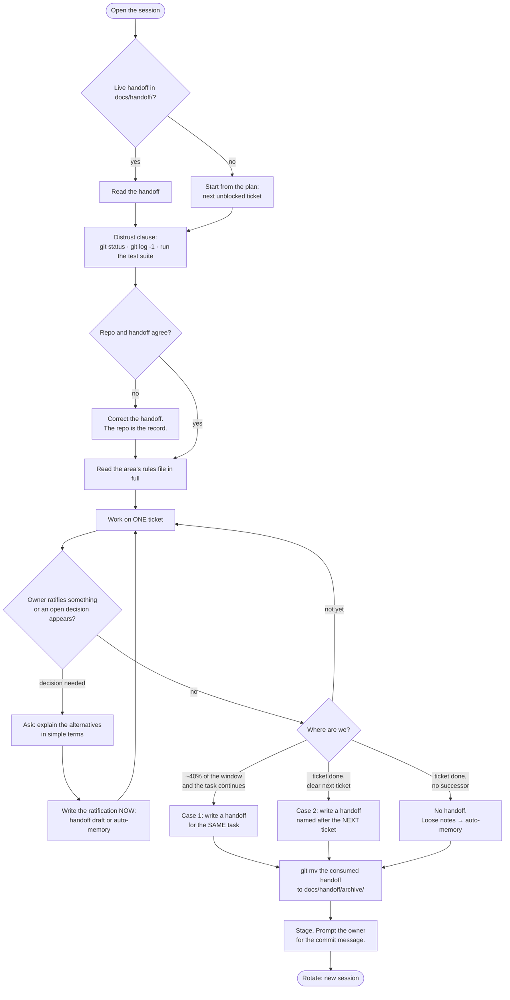
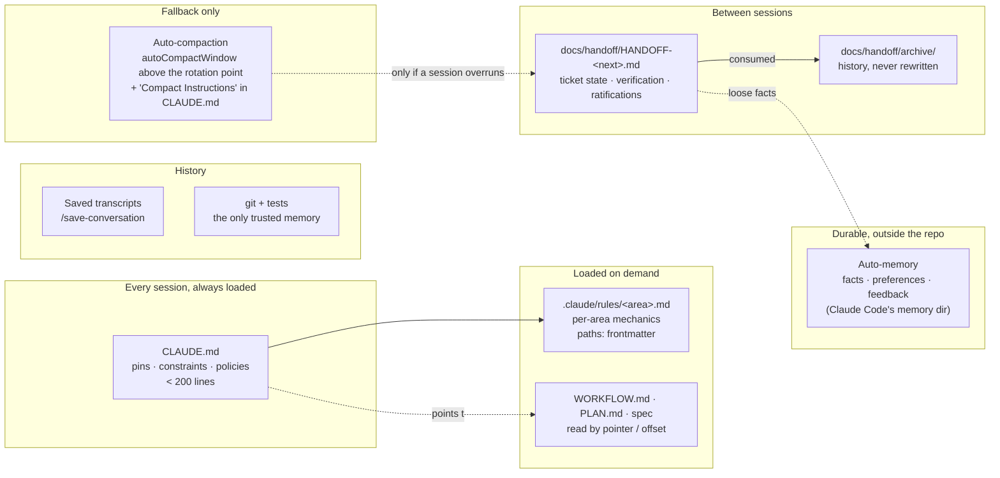
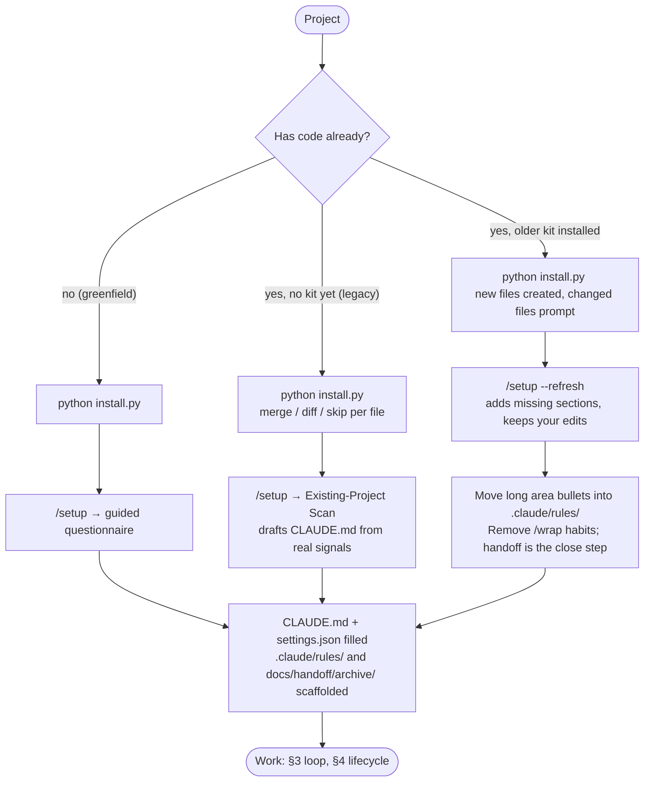

# Development Workflow — [Project Name]

> **How this file is used:** `CLAUDE.md` holds the *pins* (what must always hold) and points here for the *mechanics* (how work flows session to session). Agents read this file when a question about process comes up; humans read it once and skim it later. Fill every `<…>`; delete a section that does not apply and say so in one line.
>
> Everything here was refined over ~50 agent sessions on one real project before it became a template. The evidence behind the context-management choices is summarized in §5; the kit's `CHANGELOG.md` records why each piece is shaped the way it is.

---

## 1. Source-of-truth chain

```
<Spec / PRD / research>              ← WHAT the product is
        ↓ distilled into
<PLAN.md> (epics → tickets, dependency-ordered)   ← WHAT to build, in what order
        ↓ mirrored into
<Issue tracker board>                ← WHERE status lives
        ↓ one issue at a time
commit → <branch policy>             ← HOW code lands
```

**Rule: changes flow downhill.** When a requirement moves, or building shows the plan was wrong, edit the plan **first**, then the mirrored issue, and leave a one-line comment on the issue saying what changed and why. The board is a *status tracker*; the plan is the *spec*. If they disagree, the plan wins and the issue is stale.

**[declared]** This project's chain: `<spec location>` → `<plan file>` → `<tracker>` → `<branch / merge policy>`.

## 2. Plan anatomy and the ticket line

- **Epics** — dependency-ordered stages, each with a one-line goal. The critical path to a demoable product is marked.
- **Tickets** (`T<epic>.<n>`) — one unit of work ≈ one issue ≈ one focused commit series. A ticket line carries, in this order:
  - **Dep:** the tickets that must land first (the parallelization graph lives in these fields).
  - **Scope:** what is in and out, in two or three sentences.
  - **Spec:** a *pointer* to where the ground truth lives (a section, a line range, a URL). The ticket never duplicates the spec.
  - **LLM-assist:** what an agent can generate on its own vs. what needs a human decision.
- **Milestones** — checkpoints where something becomes *true* ("computation core green", "demoable loop", "beta-ready").
- **Registries** at the bottom of the plan: open decisions, spec-internal discrepancies with their resolutions, parked ideas. Anything ambiguous is *logged there*, never silently decided.

**When a ticket is done, the line grows a "Done" paragraph**, in place, with this shape:

> **✅ Done <YYYY-MM-DD>** — what landed, with file paths. **Ratified (<owner>, <date>):** each decision the owner made during the ticket, in the words used, *with the options not taken*. **Implementer decisions (documented in code / handoff):** the calls the agent made alone. Review ran (`/code-review`, both axes): what it fixed. Tests: N/N (M new); typecheck / lint / format state.

The ticket line is the durable record. The handoff that closed the ticket is archived (§4); the plan line is what a reader finds a year later.

## 3. The day-to-day loop

1. Pick the next unblocked ticket from the board (deps met = unblocked). **One ticket per session.**
2. Move its issue to *In progress*. Read the ticket's **Spec pointer** before writing code.
3. Read the area's rules file (`.claude/rules/<area>.md`, §6) in full before changing anything in that area.
4. Build. Definition of done: the Quality Bar in `CLAUDE.md` (tests, lint, typecheck green; no debug artifacts; project-specific gates).
5. **Risk-surface changes (the list in `CLAUDE.md`) get `/code-review` before anything is staged for push.** This review is the quality gate that a pull request would otherwise provide.
6. Stage. The commit is the human's (§7). Reference the issue in the message when one exists.
7. Close the session by the two-case rule (§4).

## 4. The session lifecycle

A session is bounded: it opens from a handoff, verifies before it trusts, records decisions as they happen, and closes by writing (or deliberately not writing) the next handoff.



**The two-case rule.** A handoff is written unprompted in exactly two cases:

1. **The same task continues in a new session** because this one has filled up (the rotation point, §5). The handoff says exactly where the work stopped.
2. **The task is done and a clear next step exists** — the next ticket in plan order. The handoff is named after the *next* ticket.

A finished topic with no successor writes **no handoff**: archive the one the session started from, put any loose fact in auto-memory, stop. Never invent a next session. The owner can always ask for one.

**Mid-ticket ratifications are written the moment they happen** — into the handoff draft or auto-memory — never held for session end. Standing rules are safe in `CLAUDE.md` (re-read every session); ad-hoc decisions are not.

**Shape and skill.** `/handoff` writes the file from `.claude/skills/handoff/template.md` (the template of record; never model a handoff on the previous one). The template's fixed parts: a verification record built only from commands run *this* session, a mandatory "Dead ends and refusals" section, the distrust clause at the top of "Next session", and the clarification line under it. `docs/handoff/` holds only live handoffs; consumed ones move to `docs/handoff/archive/` with `git mv` and live references are repointed. Archived files are history: never rewritten.

## 5. The context stack — what lives where

Context is managed in layers. Each layer has one job and one home; the lossy path (compaction) is last and is a fallback only.



| Layer | Holds | Written by | Read when |
|---|---|---|---|
| `CLAUDE.md` | Hard constraints, policies, risk surfaces, one pin bullet per area, Compact Instructions | Humans + `/setup`; agents propose edits | Always, automatically |
| `.claude/rules/<area>.md` | The full convention text for one area, verbatim and dated | The ticket that sets the convention | When a matching path is opened (and by hand before editing the area) |
| `WORKFLOW.md`, the plan, the spec | Process, ticket lines, ground truth | Humans + agents at ticket end | By pointer, never whole-file when large |
| `docs/handoff/` | Ticket state between sessions | `/handoff` at session close | Session open |
| Auto-memory | Durable facts and preferences about the owner and the project | The agent, at the moment a fact is confirmed | Session open (index) and on recall |
| Saved transcripts | What was said, condensed | `/save-conversation <slug>` | Rarely; audit and workflow history |
| Compaction | A summary of an overrun session | The harness | Only past `autoCompactWindow` |

**Rotation point and the compaction window. [declared]** The owner rotates sessions by handoff at **about 40 % of the model's window** (≈400K tokens on a 1M model) — quality drops well before the window fills, and a written handoff carries state better than a summary. `autoCompactWindow` in `.claude/settings.json` (a token count) is set **above** that point — kit default `500000`, sized for 1M-context models — so compaction only fires on a session that overran. Claude Code caps the value at the model's own window, so on a 200K-context model `500000` means "compact at the limit"; set it to about half that model's window (`100000`) if you want the same safety net there. `CLAUDE.md` carries a "Compact Instructions" section listing what a summary must keep verbatim (ticket id, file paths, ratifications, commands run and their results, what is staged). What the docs guarantee is narrower: after compaction the project-root `CLAUDE.md` is re-read from disk, so the section at least tells the post-compaction agent what to go and re-verify; path-scoped rules files are summarized away and must be read again.

**Context-window discipline inside a session (target: never exceed ~40–60 % fill):**
- Spawn subagents for anything bulky — spec reading, broad code searches, fixture generation — and keep only conclusions in the main context.
- Read large documents by offset from an index, never whole-file.
- Prefer many short single-ticket sessions over one long multi-ticket session.

**Evidence** (details and sources in the project this template came from: `docs/reference/2026-10-06-context-compaction-vs-handoff.md`): structured state beats prose summaries; verbatim beats paraphrase; standing constraints must live outside the lossy path; the new session re-reads git and tests before trusting; failure traces and completion records prevent the two costliest post-compaction behaviours — redoing finished work and retrying a refused action.

## 6. CLAUDE.md size discipline — pins in the file, mechanics in rules

`CLAUDE.md` is loaded into every session; every line costs on every turn. Keep it **under ~200 lines**. The way to grow a project without growing the file:

- **A pin stays in `CLAUDE.md`.** One bullet per area: the invariant a reviewer must know even when not editing that area, the compliance or safety rule, and the name of the rules file.
- **The mechanics move to `.claude/rules/<area>.md`**, verbatim, with `paths:` frontmatter so the harness injects the file when a matching path is read or edited:

  ```markdown
  ---
  paths:
    - "src/billing/**"
    - "supabase/migrations/*billing*"
  ---
  # Billing (set at T8.1, 2026-09-19)

  Moved verbatim from CLAUDE.md on <date>; the pin stays there under "Area conventions".

  - <the full convention text, with its dates, ratifications and the options not taken>
  ```

- **A bullet in `CLAUDE.md` is a summary, never the rule.** Before changing an area, read its rules file in full — if it is not visibly in context, `Read` it yourself. Injection is documented to happen on Read, Write or Edit of a matching file (not on a search), and an injected rule is summarized away by compaction; treat it as a convenience, not a guarantee.
- **Every file in `.claude/rules/` must carry `paths:`.** A `.md` there *without* that key is loaded into every session with the same priority as `CLAUDE.md` — which is exactly the always-on cost the split avoids. The directory is scaffolded with a `.gitkeep`, never a README.
- **A new convention goes into the rules file, and its pin into `CLAUDE.md`, in the same change.**
- **Section legend:** `[declared]` = a human answer or decision; `[discovered]` = read from the repo by `/setup` or a scan (edit if wrong); `(confirm)` = a default the owner has not yet ratified.

## 7. Commit policy and review gate

**[declared]** Commit policy: `<stage-only | auto-commit | draft-PR | never-commit>`.

The kit's default and the shape this template was refined under is **stage-only**: agents stage, the human commits and pushes. Even a commit message supplied earlier is not commit authorization. When a commit is warranted, **the agent prompts the owner with a proposed message** rather than composing one unprompted. Messages are short prose: a subject line plus at most a line or two; long reasoning belongs in the ticket line or the handoff. Reference the issue when one exists; include the internal version tag during pre-launch if the project keeps one.

**Review before push on risk surfaces.** Any change touching a path in `CLAUDE.md` "Risk Surfaces" runs `/code-review` (both axes: standards and spec) before it is staged for push. Where there are no pull requests, this is the gate.

**Branching. [declared]** `<trunk-based direct push | PR per ticket | …>`. Short-lived branches only for experimental work that might be discarded; name them `<issue-id>-<kebab-description>`.

## 8. Parallel sessions

Tickets are not strictly sequential; the `Dep:` fields define lanes. Rules for concurrent agent sessions:

- **One ticket per session.** Never two agents on the same ticket.
- Parallel sessions that *write files* use separate git worktrees.
- Work lands in dependency order; a later lane rebases onto the earlier lane's pushed work, never the reverse.
- **Schema migrations (or any other serialization point) are never written in two sessions at once.**

**[declared]** This project's lanes and serialization points: `<…>`.

## 9. Agents and models

Tiering template — adjust the model names to what is current, keep the shape:

| Work | Model tier | Rationale |
|---|---|---|
| Planning, architecture, spec analysis, hard reviews | Top tier | Judgment-heavy, ambiguity-heavy |
| Implementing well-specified tickets | Mid tier | The plan plus the spec pointer removes the ambiguity |
| Mechanical fan-out (fixtures, renames, lint fixes, doc greps) | Small tier, as subagents | Cheap, parallel |
| **Exception — risk surfaces** | Implement with any tier, **review with a top-tier model** before push | Review quality is non-negotiable where the risk is |

**Standing instruction for every session, handoff or not:** *ask the owner a clarification question whenever you are not sure of something or an open decision comes up, and explain the alternatives in simple terms.* It lives in `CLAUDE.md` "Output Preferences", in the handoff template, and in the handoff skill.

## 10. Loops

Default to turn-based work with verification skills (`/tdd`, `/code-review`). Use a goal-based loop only for a *machine-checkable* condition ("all tests pass", "typecheck clean") with an explicit turn cap. Use a time-based loop only to watch *external* state (CI, a deploy). Hard rules: one ticket-sized goal, one verifiable check, an iteration cap; never on safety- or compliance-critical code without a fresh-context review after; loop output meets the same review bar as human work; when a loop misses the bar, fix the system (encode the check as a skill), not the instance.

## 11. Skill map

| Phase | Skill |
|---|---|
| First session in a project, or when `CLAUDE.md` is stale | `/setup` (`--refresh` to pick up drift without losing edits) |
| Before building something non-trivial | `/plan-interview` |
| Test-first implementation | `/tdd` |
| Any risk-surface change, before push | `/code-review` |
| Session close (two-case rule) | `/handoff` |
| Hard bug | `/diagnosing-bugs` |
| New module design | `/codebase-design` |
| Terms getting fuzzy; a hard-to-reverse decision | `/domain-modeling` |
| A record of the conversation | `/save-conversation <slug>` |

## 12. Installing and refreshing the kit



- `install.py` never touches `README.md`; it installs `CLAUDE.md`, `WORKFLOW.md`, `.claude/` and the empty `docs/handoff/archive/` scaffold, prompting on every conflict.
- `/setup --refresh` is idempotent: discovered values are refreshed, declared sections are preserved, and sections the template gained since the last install (Area conventions, Compact Instructions, the Handoffs rule, the clarification instruction) are added if missing.
- The kit's own changes are dated in its `CHANGELOG.md`; a project's own decisions live in its plan registries, its ADRs, or its handoffs — never only in a chat.
